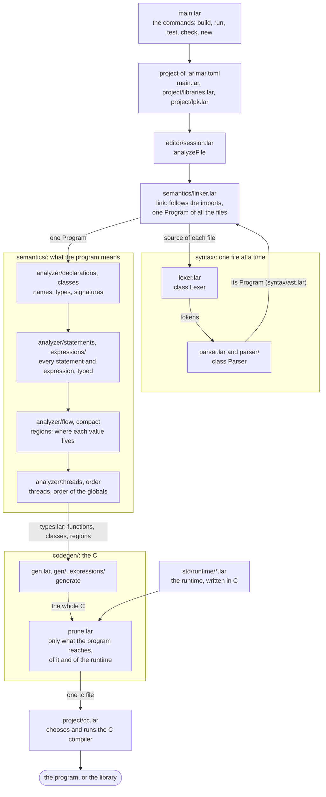
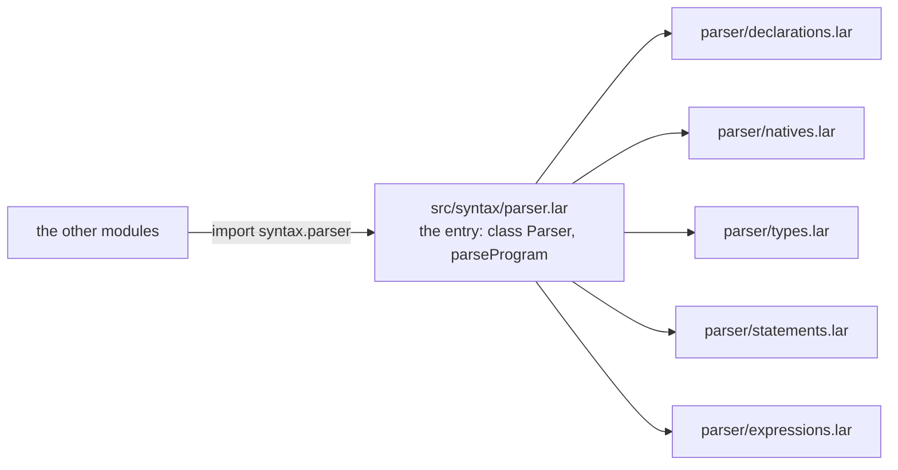
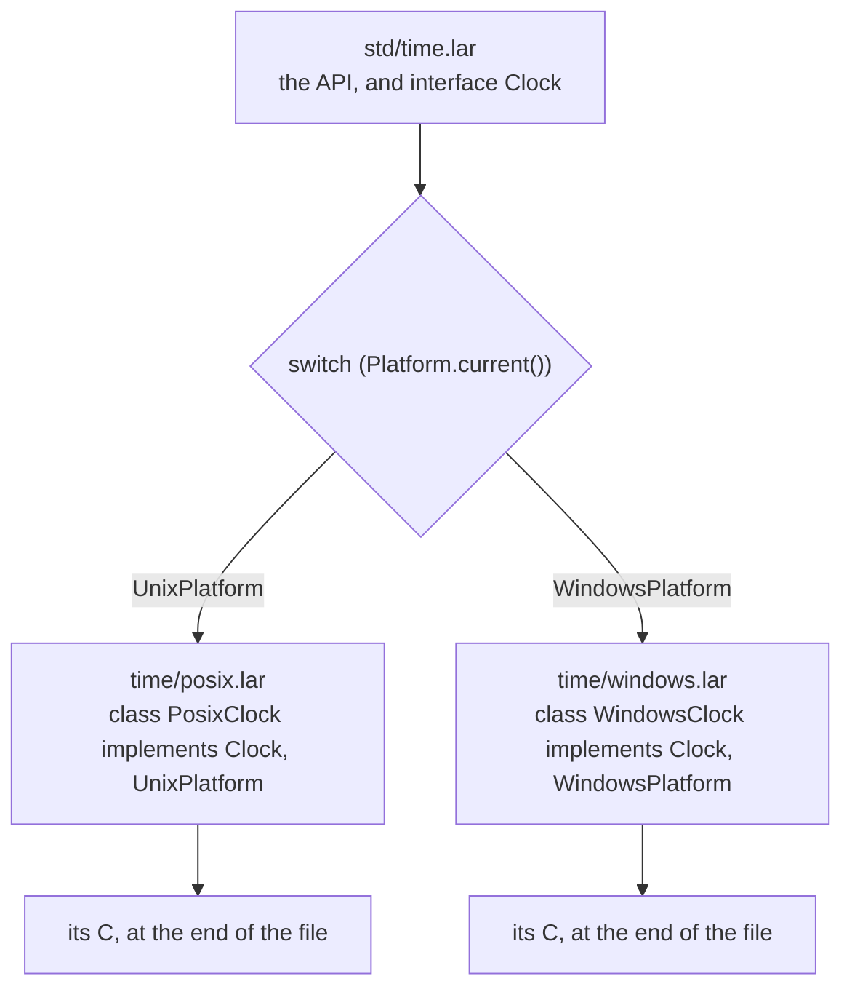
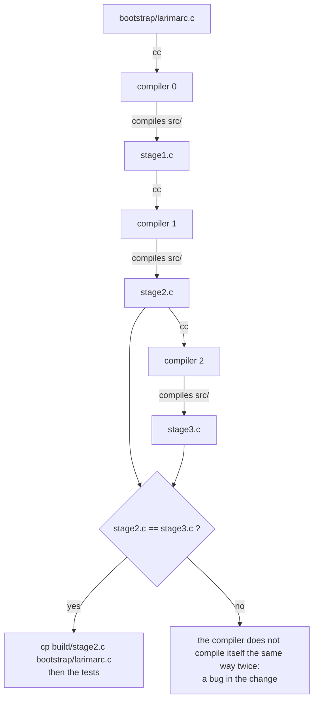

# Contributing to Larimar

How the code is organized, so that it stays easy to read and to change.

- Every function of the compiler, with its signature: [docs/compiler-reference.md](docs/compiler-reference.md).
- How libraries are made inside the compiler: [docs/compiler-libraries.es.md](docs/compiler-libraries.es.md).

## The compiler, from a file to a program

The compiler is written in Larimar (`src/`) and writes C. Each box is a module; what goes along the
arrows is on them.

The same analysis serves the editor: `editor/lsp.lar` calls `analyzeFile` for the errors, and
`editor/ide.lar` (completion, hover, go to definition) reads what it leaves in `semantics/types.lar`.
`editor/dap.lar` is apart: it sits between the editor and `lldb-dap`, and uses the debug map
(`codegen/debugmap.lar`) of a program built with `--debug`.

| Folder | What it has |
|---|---|
| `src/syntax` | The lexer, the parser, the tree (`ast.lar`) |
| `src/semantics` | The linker, the types, the analyzer |
| `src/codegen` | The generator of C, the pruning, the debug map |
| `src/project` | `larimar.toml`, packages, the C compiler, `larimar test` |
| `src/editor` | The language server and the debug adapter |
| `std` | The standard library; `std/runtime` is the runtime, in C |
| `tests` | The tests, by subject; `tests/run-tests.sh` runs them |
| `bootstrap` | `larimarc.c`: the compiler in C, to build it without a compiler |
| `docs` | The manuals, the specification and the page |

## Modules and their parts

- A file is a module: `std/net.lar` is `std.net`.
- A module that grows is split by creating **a folder with its name, next to the file**. The file stays
  as the entry: its public API (or its main class), what the others import. The folder holds its parts:
  `std/net.lar` and `std/net/posix.lar`, `std/net/windows.lar`; `src/syntax/parser.lar` and
  `src/syntax/parser/statements.lar`; `src/semantics/analyzer.lar` and `src/semantics/analyzer/flow.lar`.
- Import modules with a name: `import std.io.files as Files;` and write `Files.readString(...)`.

## Platforms

- What changes between systems is a class for each platform, marked with the platform it is for
  (`implements UnixPlatform`, `LinuxPlatform`, `MacOSPlatform`, `WindowsPlatform`), and chosen with a
  `switch (Platform.current())`. There is no `#if` written by hand.
- Each platform's class goes in a part of the module (`time/posix.lar`, `time/windows.lar`). The parts
  reach the C before the module that imports them: C shared by several parts goes in a part of its own
  that they import (`process/common.lar`).
- C is written where it is used: `native function f(...): T { C }` for a function whose C is only for it;
  `ccode { }` only for what several share (a struct, a helper).
- Names of C helpers: `lm_<module>_<thing>` (`lm_proc_start`).

Without `--target`, the C of every platform is written, each under its `#if`; with it, only one.

## Inside a file

1. The comment of the module (what it is, an example) and the imports.
2. The public API.
3. The private details, in Larimar.
4. At the end, the C: `ccode`, native functions with a body of C.

- `self.` is always written: it shows what is state.
- What gives an implementation of an interface is a static function of it (`Platform.current()`).
- Text of several lines is a text block (`"""`), not a line after another.
- `switch` with patterns instead of chains of `if (x is ...)`.
- Files of a few hundred lines: past ~800, split the module in parts.
- No mutable globals in the compiler: each phase is a class. Today `Lexer` and `Parser` are; the linker,
  the analyzer and the generator still keep their state in variables of their modules (to do).

## Changes

- `./bootstrap/build.sh --verify --test` must pass: the compiler builds itself (stage 2 == stage 3) and
  every test passes. A change to the compiler regenerates `bootstrap/larimarc.c`.

  When a change needs the new compiler to compile itself (new syntax used in `src/`), do it in two steps:
  first teach the compiler the new form and update the bootstrap, then use it in `src/`.
- The language is described in `docs/spec.md` and taught in `docs/manual.md` and `docs/manual.es.md` (the page, `docs/manual.html`, shows them): a
  change to the language changes the three.
