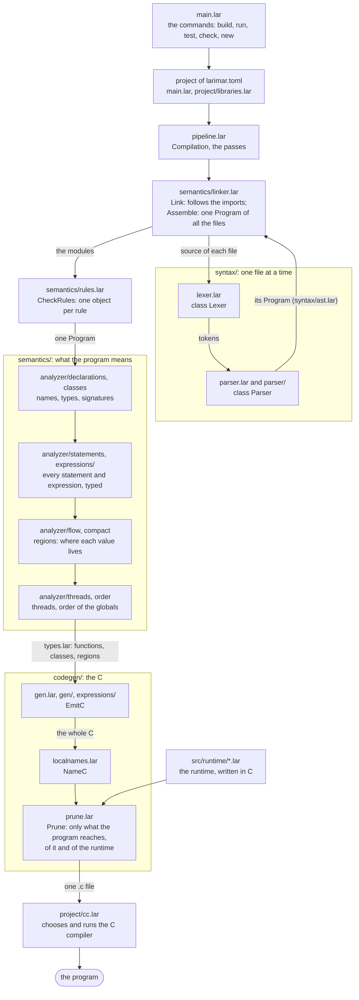
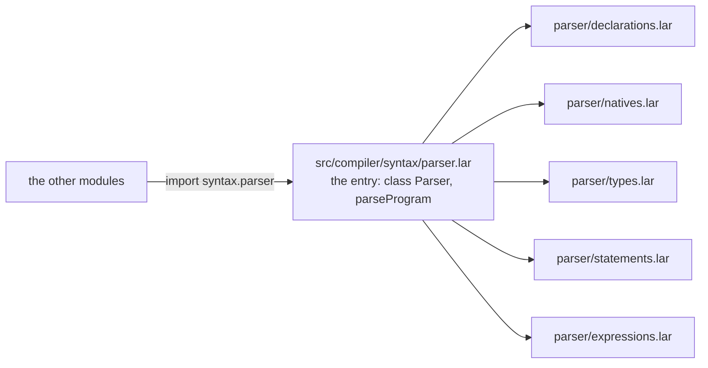
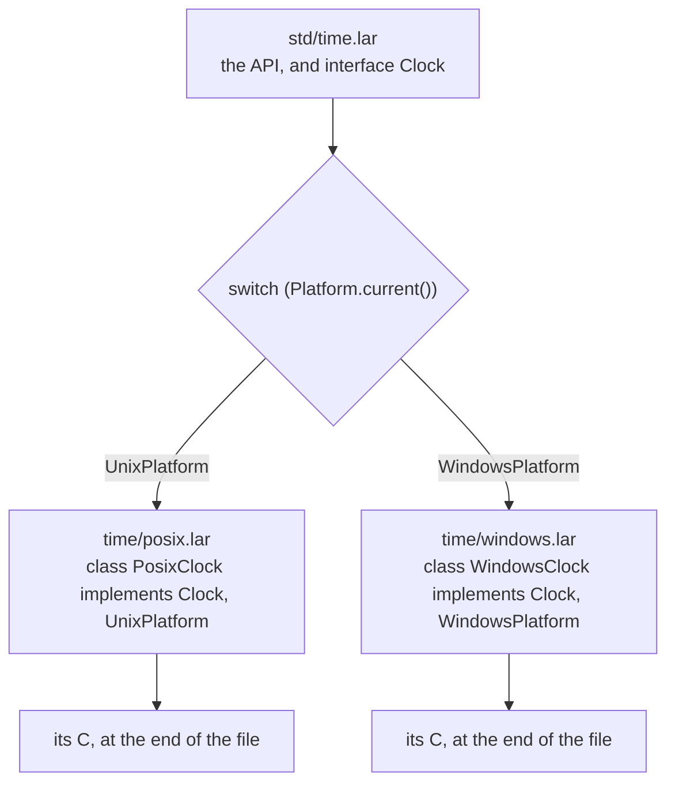
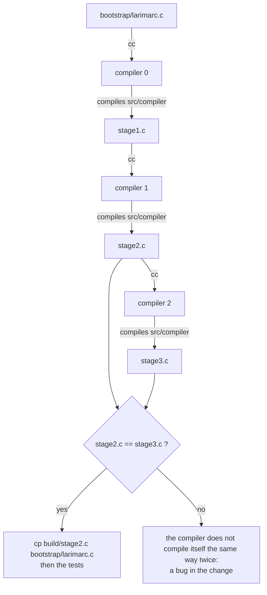

# Contributing to Larimar

How the code is organized, so that it stays easy to read and to change.

- Every function of the compiler, with its signature: [docs/compiler-reference.md](docs/compiler-reference.md)
  (`tools/reference.py`); every public name of std: [docs/std-reference.md](docs/std-reference.md)
  (`tools/std_reference.py`). Both are generated: run them after a change. `tools/reference.py` also
  writes the API part of the README.md of each folder of `src/compiler` and of `src/std`
  (`tests/project/readmes_test.lar` fails when one does not match the code).
- How libraries and tasks are made inside the compiler: [docs/compiler-libraries.es.md](docs/compiler-libraries.es.md).
- The C of the standard library (`native interface`, `cinclude`, `ccode`, `native`), for whoever writes std: [docs/std-c.md](docs/std-c.md).

## The compiler, from a file to a program

The compiler is written in Larimar (`src/compiler`) and writes C. A compilation is a `Compilation` and its
passes (`pipeline.lar`): Link, CheckRules, Assemble, Analyze, EmitC, NameC, Prune; each reports problems
instead of throwing, and the next one runs only if there were none. Each box is a module; what goes along
the arrows is on them.

The same analysis serves the editor (the passes up to Analyze): `editor/session.lar` runs them for
`larimar check` and the language server's workers, and
`editor/ide.lar` (completion, hover, go to definition) reads what it leaves in `semantics/types.lar`.
`editor/dap.lar` is apart: it sits between the editor and `lldb-dap`, and uses the debug map
(`codegen/debugmap.lar`) of a program built with `--debug`.

| Folder | What it has |
|---|---|
| `src/compiler` | The compiler: `main.lar`, `pipeline.lar`, and a folder per stage (each with a README.md) |
| `src/compiler/syntax` | The lexer, the parser, the tree (`ast.lar`) |
| `src/compiler/semantics` | The linker, the rules, the types, the analyzer |
| `src/compiler/codegen` | The generator of C, the names of its variables, the pruning, the debug map |
| `src/compiler/project` | `larimar.toml`, the libraries of `[dependencies]`, the C compiler, `larimar test` |
| `src/compiler/editor` | The language server and the debug adapter |
| `src/std` | The standard library (installed as `std/`) |
| `src/runtime` | The runtime, in C (installed as `runtime/`, beside std/) |
| `tests` | The tests, by subject; `tests/run-tests.sh` runs them |
| `bootstrap` | `larimarc.c`: the compiler in C, to build it without a compiler |
| `docs` | The manuals, the specification and the page |

## Modules and their parts

- A file is a module: `src/std/net.lar` is `std.net`, `src/compiler/syntax/parser.lar` is `syntax.parser`.
- A module that grows is split by creating **a folder with its name, next to the file**. The file stays
  as the entry: its public API (or its main class), what the others import. The folder holds its parts:
  `std/net.lar` and `std/net/posix.lar`, `std/net/windows.lar`; `syntax/parser.lar` and
  `syntax/parser/statements.lar`; `semantics/analyzer.lar` and `semantics/analyzer/flow.lar`.
- What only a folder's modules use goes in a folder `internal` of it (`tools/internal/cache.lar`): the
  rule `internal-import` keeps the rest of the program out.
- Import modules with a name: `import std.io.files as Files;` and write `Files.readString(...)`.

## Platforms

- What changes between systems is a class for each platform, marked with the platform it is for
  (`implements UnixPlatform`, `LinuxPlatform`, `MacOSPlatform`, `WindowsPlatform`), and chosen with a
  `switch (Platform.current())`. There is no `#if` written by hand.
- Each platform's class goes in a part of the module (`time/posix.lar`, `time/windows.lar`). The parts
  reach the C before the module that imports them: C shared by several parts goes in a part of its own
  that they import (`process/common.lar`).
- C is written where it is used: `native function f(...): T { C }` for a function whose C is only for it;
  `ccode { }` only for what several share (a struct, a helper).
- Names of C helpers: `lar_<module>_<thing>`, in whole words (`lar_process_start`, `lar_shared_open`); types `Lar<Thing>` (`LarSharedMemory`).

Without `--target`, the C of every platform is written, each under its `#if`; with it, only one.

## Inside a file

1. The comment of the module (what it is, an example) and the imports.
2. The public API.
3. The private details, in Larimar.
4. At the end, the C: `ccode`, native functions with a body of C.

- `self.` is always written: it shows what is state.
- What gives an implementation of an interface is a static function of it (`Platform.current()`).
- Text of several lines is a text block (`"""`), not a line after another.
- `switch` with patterns instead of chains of `if (x is ...)`.
- Files of a few hundred lines: past ~800, split the module in parts.
- The state of the compiler is in objects: `Lexer`, `Parser`, the passes and the rules are classes, and
  the state of each stage is one object the `Compilation` holds (`Linking`, `Declarations`, `Analysis`,
  `Generation`), reached in its module through one variable (`linking.order`, `declared.classes`,
  `analysis.scope`, `generation.writing`). A new variable of a stage is a field of its object, never a
  global of a module. What is left: a few variables that carry context between two functions of one
  module (`flowParams`, `selfInLambda`...), to become parameters.
- C is only the standard library's: a program and a library written in Larimar cannot have any
  (`semantics/linker.lar`, `refuseC`); what Larimar does not have runs in another process (`std.os.rpc`,
  `std.os.sharedmemory`). The compiler has no C of its own either: it is built without `--unsafe-c`, which
  stays for the tests that try std's C.
- What the compiler writes for the program is Larimar, parsed like any module: how the tasks of `Task` go
  to another process (`semantics/linker.lar`, `writeTasks`).

### Names

A name reads on its own, without going to its definition: `method`, `classInfo`, `paramTypes`,
`constantKind`, `optionalOf`, not `mi`, `ci`, `ps`, `ck`, `optT`. The short ones allowed are `id`, `url`,
`json`, `cType`, `cName`, and `i`, `j`, `k` as indexes of a loop (and a one-letter name for the element of
a short `for` or a short lambda, where its type is right there). The same goes for the C the compiler
writes: the runtime's names are `lar_` / `Lar` / `LAR_` in whole words (`LarMemory`, `lar_text_to_c`),
and its variables are named by what they are (`codegen.localnames`: `result`, `new_Shout`,
`line27_temps`, a number only when a name repeats).

## Changes

- `./bootstrap/build.sh --verify --test` must pass: the compiler builds itself (stage 2 == stage 3) and
  every test passes. A change to the compiler regenerates `bootstrap/larimarc.c`.

  When a change needs the new compiler to compile itself (new syntax used in `src/compiler`), do it in two
  steps: first teach the compiler the new form and update the bootstrap, then use it there. The same holds
  for std, which the compiler is built with: a form of std the previous compiler rejects needs it first
  taught, then used (1.10 did so for `type String { }` and for static functions with C in platform
  classes).
- The language is described in `docs/spec.md` and taught in `docs/manual.md` and `docs/manual.es.md` (the page, `docs/manual.html`, shows them): a
  change to the language changes the three.
