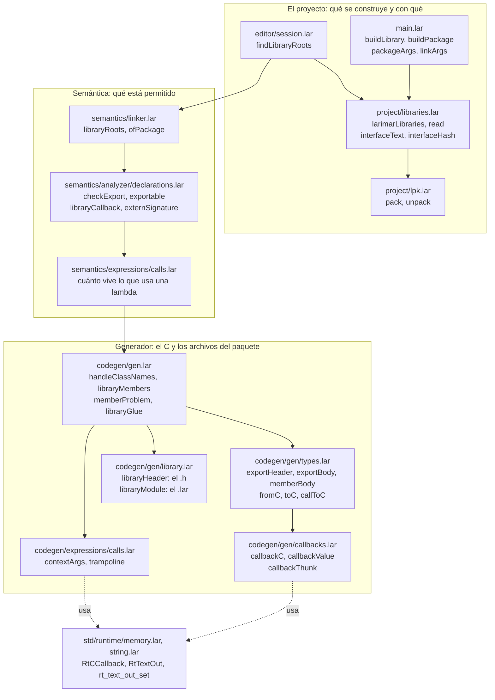
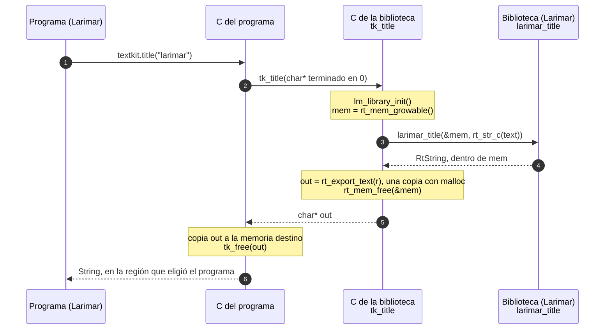
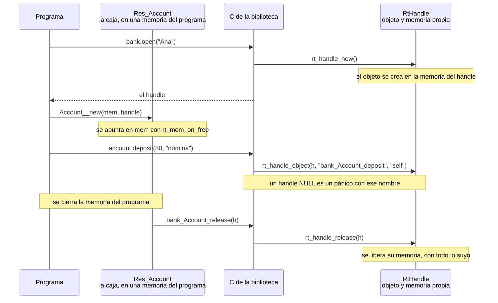
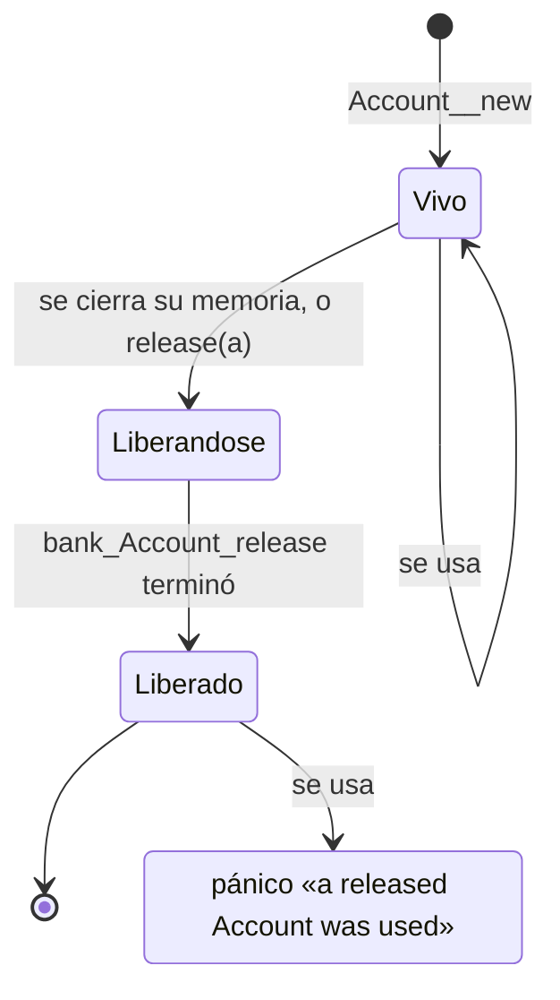
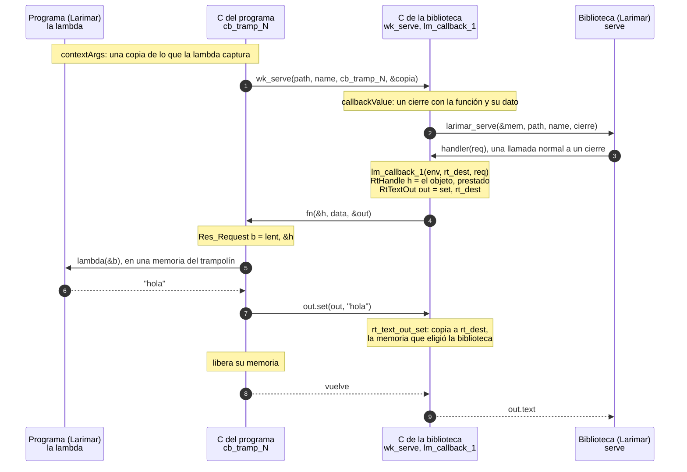
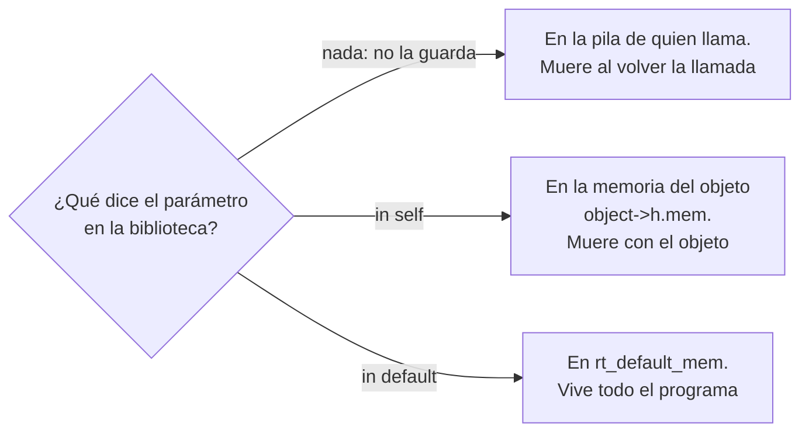
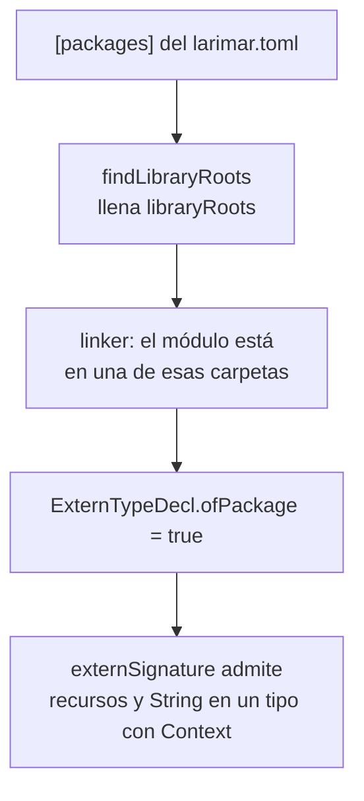
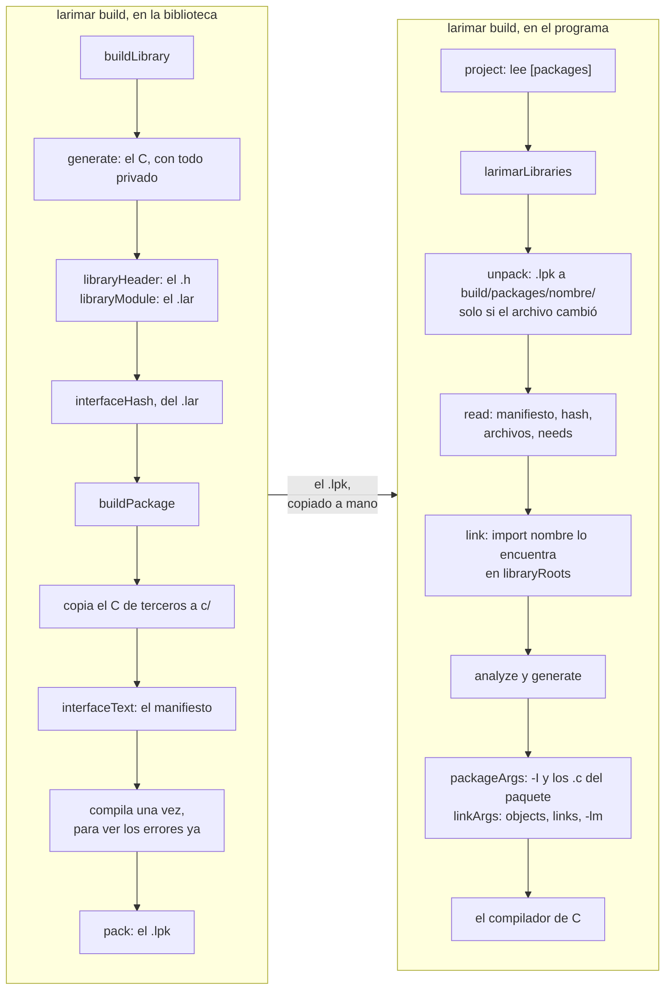
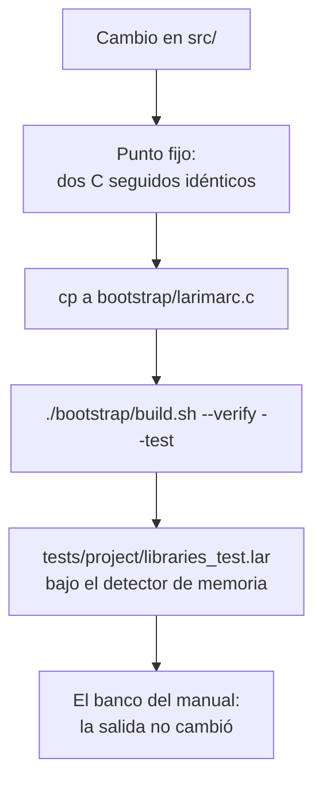

# Bibliotecas: cómo están hechas en el compilador

Para quien tenga que **tocar el compilador**. Dice dónde vive cada pieza de las bibliotecas escritas en
Larimar y qué recorre una llamada, con los nombres reales de las funciones.

- Para escribir o usar una biblioteca: [libraries.es.md](libraries.es.md). No hace falta nada de esto.
- Cómo se organiza el código en general: [CONTRIBUTING.md](../CONTRIBUTING.md).
- Cada función del compilador, con su firma: [compiler-reference.md](compiler-reference.md).

Los diagramas se comprobaron contra el C que el compilador genera para los ejemplos del manual
(`textkit`, `bank`, `webkit`).

## Contenido

1. [El mapa](#1-el-mapa)
2. [Una llamada del programa a la biblioteca](#2-una-llamada-del-programa-a-la-biblioteca)
3. [Un objeto](#3-un-objeto)
4. [Una función del programa](#4-una-función-del-programa)
5. [Las reglas especiales del binding de un paquete](#5-las-reglas-especiales-del-binding-de-un-paquete)
6. [Construir y usar un paquete](#6-construir-y-usar-un-paquete)
7. [Si quieres cambiar…](#7-si-quieres-cambiar)
8. [Lo que cuesta mantener](#8-lo-que-cuesta-mantener)

---

## 1. El mapa

Una biblioteca toca doce archivos. El diagrama los agrupa por el momento en que trabajan; las flechas
son «pasa su resultado a».



| Archivo | Qué hace para las bibliotecas |
|---|---|
| `src/main.lar` | `buildLibrary`: construir una biblioteca. `buildPackage`: llenar la carpeta, copiar el C, escribir el manifiesto, hacer el `.lpk`. `packageArgs` y `linkArgs`: lo que un paquete añade al compilar un programa |
| `src/project/libraries.lar` | `larimarLibraries` y `read`: leer `[packages]`, desempaquetar, comprobar el hash. `interfaceText`: el texto del manifiesto. `interfaceHash` |
| `src/project/lpk.lar` | `pack` y `unpack`: el zip sin comprimir |
| `src/editor/session.lar` | `findLibraryRoots`: lee el `larimar.toml` del archivo que se compila y llena `libraryRoots`; decide `libraryRules` (el proyecto es una biblioteca) |
| `src/semantics/linker.lar` | `libraryRoots`: dónde está el `.lar` de cada paquete. Marca `ofPackage` en los tipos de ese `.lar` |
| `src/semantics/analyzer/declarations.lar` | `checkExport` y `exportable`: qué puede cruzar. `libraryCallback`: qué tipos de función cruzan. `externSignature`: las reglas de un tipo de función de C |
| `src/semantics/expressions/calls.lar` | Lo que usa una lambda vive tanto como quien la guarda (`in default`, `in self`) |
| `src/codegen/gen.lar` | `handleClassNames`, `libraryMembers`, `memberProblem`: qué clases y qué miembros cruzan. `libraryGlue`: `_free`, `_release`, `_give`, `_interface` |
| `src/codegen/gen/types.lar` | `exportHeader`, `exportBody`, `memberBody`: la función C de cada función y método exportado. `fromC`, `toC`, `callToC`: convertir valores al entrar y al salir |
| `src/codegen/gen/callbacks.lar` | Una función del programa, del lado de la biblioteca. Su cabecera explica el mecanismo entero |
| `src/codegen/gen/library.lar` | `libraryHeader`: el `.h`. `libraryModule` y `bindingClass`: el `.lar` |
| `src/codegen/expressions/calls.lar` | `contextArgs` y `trampoline`: del lado del programa, la función C que llama a su lambda |
| `std/runtime/memory.lar`, `string.lar` | `RtCCallback`, `RtTextOut`, `rt_text_out_set` |

---

## 2. Una llamada del programa a la biblioteca

`textkit.title("larimar")`. La biblioteca trabaja en una memoria que dura lo que la llamada; el texto
sale como una copia hecha con `malloc`, y el programa la copia a su destino y la devuelve.



- Los pasos 2 a 5, que son la función `tk_title`, los escribe `exportBody` con `callToC`
  (`codegen/gen/types.lar`).
- Lo que hace el programa entre los pasos 5 y 6 sale del binding: `released by tk_free` hace que el
  compilador copie el texto a donde va el resultado y libere el original.
- Por eso cada lado libera solo lo que reservó.

El C real, de `textkit`:

```c
char* tk_title(const char* text_c) {
    lm_library_init();
    RtMem mem = rt_mem_growable();
    RtString r = larimar_title(&mem, rt_str_c(text_c));
    char* out = rt_export_text(r);
    rt_mem_free(&mem);
    return out;
}
```

---

## 3. Un objeto

Del lado de la biblioteca, un handle es un `RtHandle`: el objeto y **su propia memoria**. Del lado del
programa va dentro de una caja `Res_Account` que sabe en qué memoria del programa está.



Los estados de la caja, que es lo que impide usar o liberar dos veces:



Un objeto que la biblioteca **presta** a una función del programa (sección 4) lleva otra función de
liberar, `rt_res_lent`, que no hace nada: el programa no puede quitárselo.

---

## 4. Una función del programa

Para `webkit.serve("/hi", "ana", (req) -> { return "hola"; })`.

El recorrido entero está también en la cabecera de `src/codegen/gen/callbacks.lar`.



Tres detalles que no son evidentes:

- **El texto no se devuelve; se entrega (paso 7).** `out` lleva un puntero a la función que copia
  (`set`). El programa llama a esa función, que es de la biblioteca, así que la copia se hace con el
  asignador de la biblioteca y en la memoria que ella eligió. Es lo único de `RtTextOut` que los dos
  lados tienen que entender igual.
- **El objeto se presta con `rt_res_lent` (pasos 4 y 5).** La caja que recibe la lambda tiene una función de
  liberar que no hace nada: `release(req)` dentro de la lambda no le quita el objeto a la biblioteca.
- **Dónde va la copia de lo que la lambda captura** lo decide `contextArgs`:



El analizador exige lo mismo de lo que la lambda usa (`semantics/expressions/calls.lar`): `ctxKeep`
llama a `mustLiveForever`, y `ctxSelf` compara la región de la lambda con la del objeto.

El C real del lado de la biblioteca, de `webkit`:

```c
static RtString lm_callback_1(void* env, RtMem* rt_dest, Request* a0) {
    RtCCallback* c = (RtCCallback*)env;
    RtHandle h0 = { .object = a0 };
    RtTextOut out = { rt_text_out_set, rt_dest, rt_str_c("") };
    ((void (*)(void*, void*, void*))c->fn)(&h0, c->data, &out);
    return out.text;
}
```

---

## 5. Las reglas especiales del binding de un paquete

Un tipo de función de C con `Context` normalmente no puede dar un `String` ni recibir un recurso. En el
`.lar` de un paquete sí, porque la biblioteca sigue la convención de la sección 4.



No hay sintaxis para ello: depende de dónde está el archivo.

---

## 6. Construir y usar un paquete



El hash une las dos mitades: es el SHA-256 (8 dígitos) del `.lar`, está en el manifiesto y también
dentro del C. `read` los compara, y un binding editado a mano o archivos de dos builds mezclados no
pasan.

---

## 7. Si quieres cambiar…

| Quieres | Toca |
|---|---|
| Que cruce un tipo nuevo | `exportable` (analizador); `fromC`, `toC`, `abiType` (`gen/types.lar`); `headerType`, `bindingType` (`gen/library.lar`) |
| Que una función del programa lleve un tipo nuevo | `libraryCallback`; `callbackC`, `callbackThunk` (`gen/callbacks.lar`); `trampoline` (`codegen/expressions/calls.lar`) |
| Un campo nuevo en el manifiesto | `interfaceText` y `read` (`project/libraries.lar`); `buildPackage` (`main.lar`) |
| Lo que un paquete añade al compilar | `packageArgs`, `linkArgs` (`main.lar`) |
| El formato del `.lpk` | `project/lpk.lar` |
| Los comentarios del `.h` | `callbackTypedef`, `typeNote`, `resultNote` (`gen/library.lar`) |
| Qué miembros de una clase cruzan | `memberProblem`, `crosses` (`gen.lar`) |

Después de cualquier cambio:



---

## 8. Lo que cuesta mantener

- **El mecanismo está repartido.** Aunque `gen/callbacks.lar` reúne el lado de la biblioteca, una función
  del programa toca analizador, dos generadores, el runtime y el linker. Un cambio en la convención hay
  que hacerlo en los dos lados a la vez, o se rompe en silencio.
- **La regla de la sección 5 no se ve en el código fuente** de un binding: depende de la carpeta.
- **El nombre de la variable `c`** se usa para cosas distintas en estos archivos (una clase, una llamada,
  un texto de C).
- **Una biblioteca compilada (`--static`, `--dynamic`) sigue escribiendo su `.lar`**, que hoy ningún
  programa Larimar puede usar: `[packages]` solo admite paquetes. O se deja de escribir, o se vuelven a
  admitir las compiladas; mientras, es salida sin uso.
- **Solo se ha ejecutado en Linux.** Para Windows y macOS el C se compila, pero nada de esto se ha corrido.
