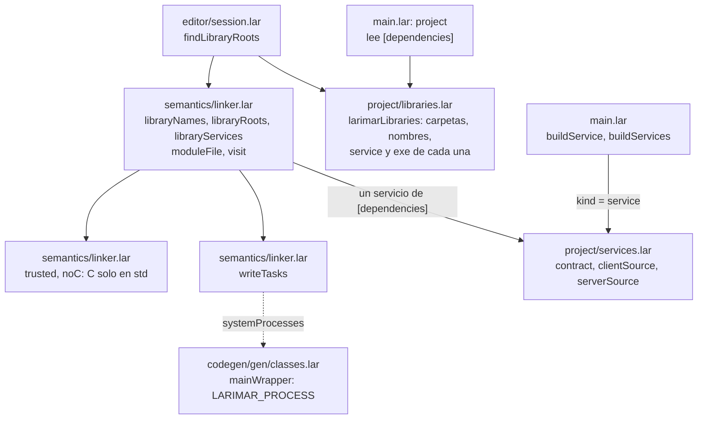
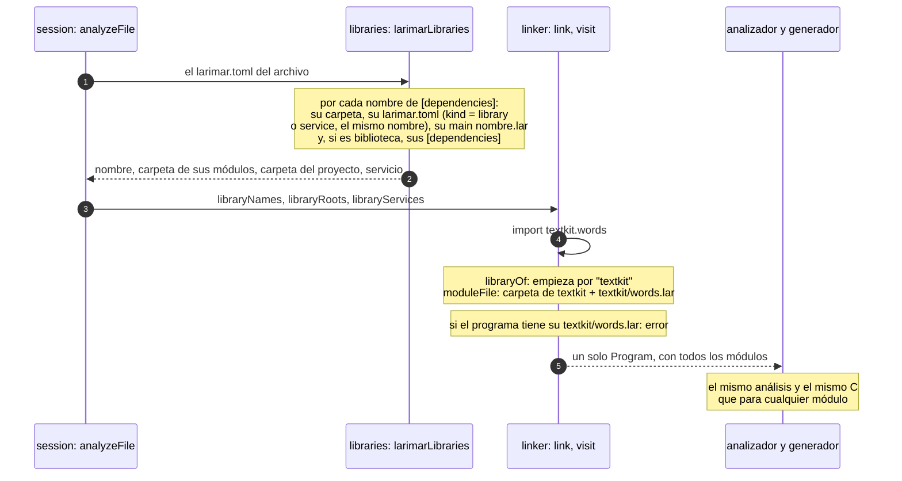
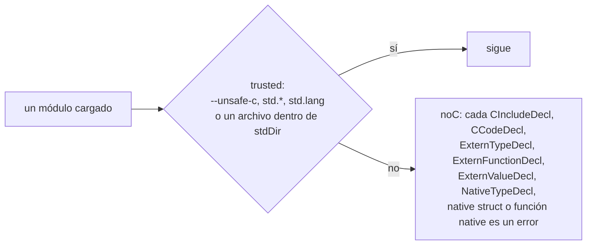
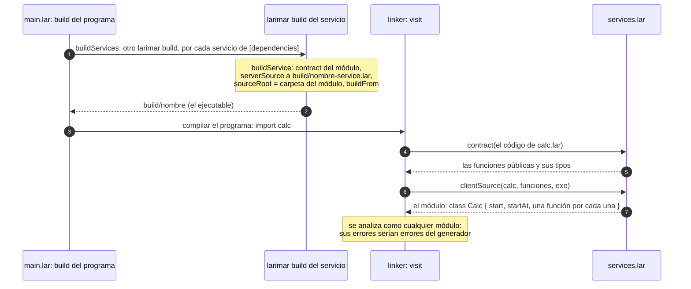
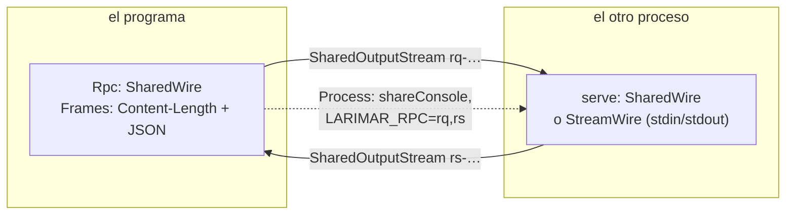
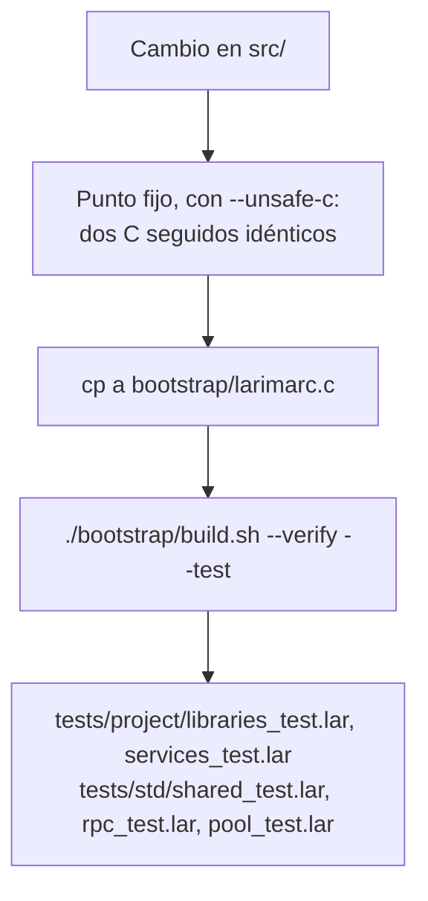

# Bibliotecas, servicios y tareas: cómo están hechos en el compilador

Para quien tenga que **tocar el compilador**. Dice dónde vive cada pieza de las bibliotecas, los servicios
y las tareas (`Task`), y qué recorre cada caso, con los nombres reales de las funciones.

- Para escribir o usar una biblioteca o un servicio: [libraries.es.md](libraries.es.md) y el capítulo 27 del
  [manual](manual.es.md). No hace falta nada de esto.
- Cómo se organiza el código en general: [CONTRIBUTING.md](../CONTRIBUTING.md).
- Cada función del compilador, con su firma: [compiler-reference.md](compiler-reference.md).
- El C de la biblioteca estándar: [std-c.md](std-c.md).

Los tres casos comparten una idea: **lo que el compilador escribe para el programa es Larimar**, que se
analiza como cualquier módulo. No hay C a mano para ellos en el compilador; el C que hace falta (la
memoria compartida, los procesos) está en std.

- **Una biblioteca** es código fuente que el linker carga como módulos del programa. Lo hacen
  `project/libraries.lar`, `editor/session.lar` y `semantics/linker.lar`.
- **Un servicio** es un proyecto aparte. Para el programa, el linker escribe un módulo con una clase cuyas
  llamadas van al ejecutable del servicio (`project/services.lar`, `clientSource`); para el servicio,
  `main.lar` escribe el main de su ejecutable (`serverSource`).
- **Una tarea** es un objeto de una clase que implementa `std.os.process.Task` (importada por nombre o
  por un alias de ese módulo: `taskInterface`). El linker escribe, en cada módulo que tiene esas clases,
  cómo sus objetos van a otro proceso; escribe `std.os.process.tasks` para que pregunte a esos módulos, y
  cambia `encodeTask` y `startTask` de `std.os.process` para que le pregunten a él (`writeTasks`). std no
  importa `tasks`: así no tiene ciclos.

## Contenido

1. [El mapa](#1-el-mapa)
2. [Una biblioteca en un programa](#2-una-biblioteca-en-un-programa)
3. [C solo en la biblioteca estándar](#3-c-solo-en-la-biblioteca-estándar)
4. [Un servicio](#4-un-servicio)
5. [Las tareas](#5-las-tareas)
6. [Lo que hay debajo: std.os.rpc y std.os.shared](#6-lo-que-hay-debajo-stdosrpc-y-stdosshared)
7. [Si quieres cambiar…](#7-si-quieres-cambiar)
8. [Lo que cuesta mantener](#8-lo-que-cuesta-mantener)

---

## 1. El mapa



| Archivo | Qué hace |
|---|---|
| `src/project/libraries.lar` | `larimarLibraries`: las bibliotecas y servicios de `[dependencies]`, comprobados (`libraryConfig`). De un servicio guarda `service` y `exe` (donde se construye su ejecutable) y no lee sus `[dependencies]` |
| `src/editor/session.lar` | `findLibraryRoots`: lee el `larimar.toml` del archivo que se compila y llena `libraryNames`, `libraryRoots` y `libraryServices` |
| `src/semantics/linker.lar` | `libraryOf` y `moduleFile`: un módulo `nombre` o `nombre.parte` se busca en la carpeta de su biblioteca. `visit`: el choque con un archivo del programa, y para un servicio el módulo escrito por `clientSource` en vez de su archivo. `writeTasks`: las tareas. `trusted` y `noC`: la regla de C |
| `src/project/services.lar` | `contract`: las funciones públicas del servicio y sus tipos. `clientSource`: el módulo que importa el programa. `serverSource`: el main del ejecutable |
| `src/main.lar` | `project`: `kind` (`program`, `library`, `service`) y `[dependencies]`. `checkLibrary`, `buildService`, `buildServices`, `createService`. `--unsafe-c` |
| `src/codegen/gen/classes.lar` | `mainWrapper`: con `systemProcesses`, una copia arrancada por un `ProcessPool` corre `serveTasks` en vez de `main` |
| `std/os/process.lar`, `std/os/process/tasks.lar` | `Task`, `Process { run }`, `ProcessPool`, `serveTasks`, `encodeTask`/`startTask`; `tasks.lar` es cómo es ese módulo en un programa sin tareas |
| `std/os/rpc.lar`, `std/os/shared.lar` | JSON-RPC y los streams de memoria compartida, sobre los que va todo lo demás |

---

## 2. Una biblioteca en un programa

No hay frontera: la biblioteca son módulos más del programa. Lo único especial es dónde se buscan sus
archivos.



- Los nombres de C de un módulo de biblioteca salen de su ruta (`textkit__words__of`), como los de
  cualquier módulo: no chocan con los del programa.
- `larimar check` y el editor usan el mismo camino, así que ven las bibliotecas igual que `larimar build`.
- Los problemas de `[dependencies]` (sin carpeta, un programa, otro nombre, dos con el mismo nombre) los dice
  `project` en `main.lar`, antes de compilar; `findLibraryRoots` los ignora.
- `larimar build` de una biblioteca la revisa (`checkLibrary`: `analyzeFile` sin generar C).

---

## 3. C solo en la biblioteca estándar



- La comprobación está en `link`, después de cargar todos los módulos, así que vale igual para un
  programa, una biblioteca, un servicio y el editor.
- El compilador no tiene C propio: `bootstrap/build.sh` y `build.ps1` lo construyen sin `--unsafe-c`.
  El servidor de lenguaje y el depurador arrancan sus procesos con `std.os.process` y esperan la
  entrada con `Console.waitForInput`. `--unsafe-c` queda en `tests/run-tests.sh` y en los ayudantes
  de `tests/support/compiler.lar`, para los casos de prueba que traen C propio. `larimar test --unsafe-c` lo pasa a cada
  `test-main` (`project/testing.lar`).

---

## 4. Un servicio



- **El contrato** son las funciones públicas de primer nivel del módulo principal del servicio
  (`contract`, sobre el AST de `parseProgram`). Un tipo que no cruza, o un `throws`, es un problema que
  dicen `buildService` (`Service Error [...]`) y el linker del programa.
- **El módulo del programa** (`clientSource`) tiene una clase con `rpc: Rpc`. Cada función arma una tabla
  con sus parámetros por nombre (`toAny`), llama `self.rpc.call` y convierte el resultado (`declareFrom`).
  `start()` busca el ejecutable junto al del programa y si no en `exe`, y lo arranca con `Rpc.startShared`.
- **El main del servicio** (`serverSource`) es un `serve((call) -> ...)` con un `if` por función: lee cada
  parámetro de `call.params`, llama a la función del módulo y devuelve el resultado como `Any`. Se escribe
  en la carpeta de build, donde se puede leer.
- **Un servicio no lee sus `[dependencies]` en el programa**: van dentro de su ejecutable, que se construye con
  su propio `larimar build`, en otro proceso del compilador (el compilador guarda estado global: dos
  programas en un mismo proceso se mezclarían).
- Importar una parte del servicio (`calc.inner`) es un error de `visit`.

---

## 5. Las tareas

```mermaid
sequenceDiagram
    autonumber
    participant K as linker: link
    participant W as writeTasks
    participant G as generador
    participant P as Process o ProcessPool (en el programa)
    participant C as la copia del programa

    K->>W: después de visit(root), antes de loadLang
    Note over W: por cada módulo que no es de std: sus clases<br/>con implements Task (de std.os.process).<br/>Comprueba los campos y que no extienda otra clase
    W->>W: añade al módulo larimarTaskEncode y larimarTaskStart<br/>(Larimar, parseado con la línea de la clase)
    W->>W: escribe std.os.process.tasks: import de cada módulo,<br/>encode y start le preguntan a cada uno
    W->>W: std.os.process: import de tasks;<br/>encodeTask y startTask le preguntan
    W-->>K: taskClasses = true
    K->>G: mainWrapper: if (getenv("LARIMAR_PROCESS")) serveTasks
    P->>C: Calls.startSharedWith(programPath, [], LARIMAR_PROCESS=1)
    P->>C: begin("run", encodeTask(tarea))
    Note over C: init_globals, serveTasks:<br/>startTask(nombre, campos).run()
    C-->>P: finish(id): lo que dio run()
```

- **`larimarTaskEncode(task)`** prueba `task is Clase t` por cada clase del módulo y da
  `{ name: "módulo.Clase", fields: {...} }`. **`larimarTaskStart(name, fields)`** hace el objeto con un
  literal de todos sus campos; las listas se llenan después con `push`, porque una lista creada antes en
  la función viviría menos que el objeto.
- Los campos se escriben con corchetes (`f["nombre"]`): `fields`, `length` y `push` son palabras de `Any`.
- El módulo principal se importa por su ruta desde la carpeta del proyecto (`modulePathOf`; en las pruebas,
  también desde la carpeta de encima, como hace `moduleFile`). Ese import lo resuelve `visit` como el del
  archivo abierto solo que importan sus partes.
- `tasks` se crea en `writeTasks` (no viene de un import) y va al final de `order` (`visit`), así que se
  analiza después de los módulos que importa.
- La copia corre `init_globals` y después `serveTasks`: los globales del programa existen, `main` no corre.
- Un `Process { run: tarea }` arranca una copia en `start()` (`begin`) y la espera en `join()` (`finish`).
  Un `ProcessPool` es un `Rpc[*]`: `submit` reparte con `begin` a un trabajador libre (arranca otro hasta
  `processes`) y `wait` recoge con `finish`; ante un `RpcError` para todos (`stop`), vacía las listas y
  lanza `ProcessError.Failed`.

---

## 6. Lo que hay debajo: std.os.rpc y std.os.shared



- **El anillo** (`std/os/shared/common.lar`) es un productor y un consumidor: `head` lo mueve solo quien
  escribe y `tail` solo quien lee, con stores de liberación y loads de adquisición (`__atomic_*`; en tcc,
  `mfence`). Un lado que espera gira 100 µs y después duerme en pasos que crecen (`lm_shm_wait`).
- **El otro lado vivo** se mira cada 50 ms (`lm_shm_peer`): en Unix con `waitid(WNOWAIT)` para un hijo que
  terminó y no se esperó todavía (si no, `kill(pid, 0)` lo vería vivo), y si no con `kill`; en Windows con
  `OpenProcess` y `WaitForSingleObject`.
- **El nombre** (`/lar.<nombre>` en Unix, `Local\lar.<nombre>` en Windows) lo borra quien abre en cuanto
  está dentro (`lm_shm_open`), así que no queda nada si un programa muere. Uno que quedó de un programa
  que ya no corre se recupera al crearlo (`lm_shm_create`).
- **Rpc** espera las respuestas en pasos de 200 ms para ver si el proceso terminó (`SharedWire.receive`,
  `PipeWire.receive`): una llamada nunca espera a un programa muerto.
- En Linux, `#define LM_OS_SHARED` hace que se enlace `-lrt` (`project/cc.lar`, `systemLibraries`).

---

## 7. Si quieres cambiar…

| Quieres | Toca |
|---|---|
| Cómo se busca o se comprueba una biblioteca o un servicio de `[dependencies]` | `collect`, `libraryConfig` (`project/libraries.lar`) |
| Qué módulos son de una biblioteca | `libraryOf`, `moduleFile`, `visit` (`semantics/linker.lar`) |
| Dónde se permite C | `trusted`, `noC` (`semantics/linker.lar`) |
| Qué tipos cruzan a un servicio | `crosses`, `fromAny`, `toAny`, `declareFrom` (`project/services.lar`) |
| El módulo que importa el programa de un servicio | `clientSource` (`project/services.lar`) |
| El main del ejecutable de un servicio | `serverSource`; `buildService` (`main.lar`) |
| Qué campos lleva una tarea | `TASK_SCALARS`, `taskScalar`, `fromTable`, `writeTasks` (`semantics/linker.lar`) |
| Cómo arranca una copia | `mainWrapper` (`codegen/gen/classes.lar`), `serveTasks` y `TASKS_ENV` (`std/os/process.lar`) |
| El protocolo | `Frames`, `framed`, `lengthOf` y los `Wire` (`std/os/rpc.lar`) |
| Cómo esperan los streams | `lm_shm_wait`, `lm_shm_sys_nap` (`std/os/shared/common.lar`, `posix.lar`, `windows.lar`) |

Después de cualquier cambio en `src/`:



---

## 8. Lo que cuesta mantener

- **El código que escribe el compilador está en textos.** `clientSource`, `serverSource` y `writeTasks`
  arman Larimar con `StringBuilder`; un error en ellos sale como un error de análisis del módulo generado.
  El de un servicio se puede leer en `build/<nombre>-service.lar`.
- **Todo cruza por JSON**, también sobre memoria compartida: es simple y se puede leer, pero cada llamada
  serializa. Para datos grandes están los streams.
- **Solo se ha ejecutado en Linux.** Para Windows el C se compila (mingw), y para macOS no se ha compilado
  en este equipo: `waitid` y `shm_open` existen allí, pero nada de esto se ha corrido.
