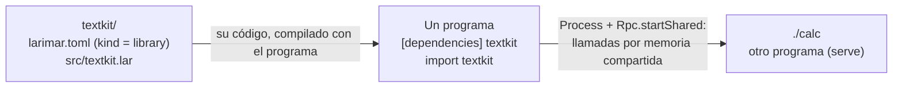
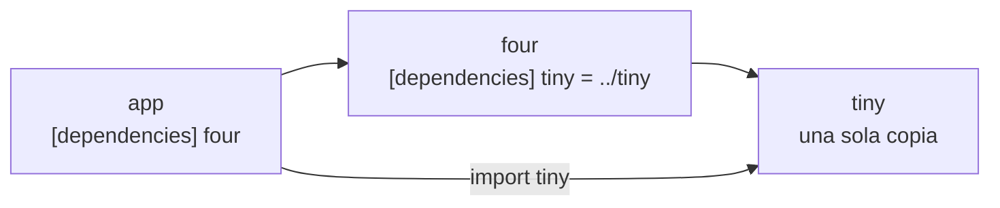
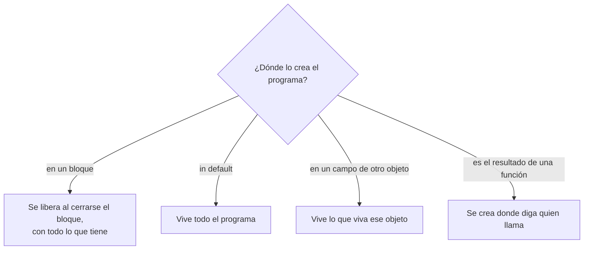

# Bibliotecas en Larimar: manual de desarrollo

Versión descrita: Larimar 1.12.0 (lenguaje 1.4). La referencia breve está en el
[manual, capítulo 27](manual.es.md#27-bibliotecas-escritas-en-larimar). Cómo está hecho esto dentro del
compilador, para quien vaya a tocarlo, está aparte: [compiler-libraries.es.md](compiler-libraries.es.md).

Cada ejemplo de este manual se escribió en una carpeta, se construyó y se ejecutó con esa versión, y lo
que aparece como salida es lo que imprimió: 34 ejecuciones. Los programas corrieron con el detector
de memoria (`-fsanitize=address`, con detección de fugas). Ninguno dio avisos.

## Contenido

**Parte I. Conceptos**

1. [El modelo](#1-el-modelo)
2. [Las reglas de memoria](#2-las-reglas-de-memoria)

**Parte II. Bibliotecas para programas Larimar**

3. [La primera biblioteca](#3-la-primera-biblioteca)
4. [Todo el lenguaje cruza](#4-todo-el-lenguaje-cruza)
5. [Los módulos de una biblioteca](#5-los-módulos-de-una-biblioteca)
6. [Una biblioteca que usa otras](#6-una-biblioteca-que-usa-otras)
7. [Estado, objetos e hilos](#7-estado-objetos-e-hilos)
8. [Probar una biblioteca](#8-probar-una-biblioteca)
9. [Errores de `[dependencies]`](#9-errores-de-dependencies)
10. [Sin C propio](#10-sin-c-propio)

**Parte III. Otro programa: código en su propio proceso**

11. [Un programa que responde](#11-un-programa-que-responde)
12. [Qué cruza, y qué pasa si falla](#12-qué-cruza-y-qué-pasa-si-falla)
13. [Desde otros lenguajes](#13-desde-otros-lenguajes)

**Parte IV. Seguridad y límites**

14. [Qué se comprobó](#14-qué-se-comprobó)
15. [Lo que el compilador no puede impedir](#15-lo-que-el-compilador-no-puede-impedir)
16. [Límites conocidos](#16-límites-conocidos)

**Apéndices**

- [A. Qué prueba de la suite cubre cada cosa](#a-qué-prueba-de-la-suite-cubre-cada-cosa)
- [B. Chuleta](#b-chuleta)

---

# Parte I. Conceptos

## 1. El modelo

El código escrito en Larimar se comparte como biblioteca, que un programa nombra en su `[dependencies]`;
lo que debe ir aparte es otro programa, que el programa arranca y al que llama:



- **Una biblioteca** (`kind = "library"`): el programa compila su código junto con el suyo. No hay nada que
  construir antes, ni archivos intermedios: la biblioteca es código Larimar como el del programa.
- **Otro programa**: corre en un proceso propio y responde con `serve`. El programa lo arranca con un
  `Process` y `Rpc.startShared`, y cada llamada va allí. Lo que falle allí se queda allí: aquí es un error
  de la llamada ([Parte III](#parte-iii-otro-programa-código-en-su-propio-proceso)).

### 1.1 Una biblioteca: un solo programa

Compilada con el programa, la biblioteca no es un mundo aparte:

- **El mismo C, el mismo runtime.** El programa y sus bibliotecas acaban en un solo archivo C, con una sola
  copia del runtime (memorias, textos, hilos).
- **El mismo lenguaje a los dos lados.** Clases, interfaces que el programa implementa, listas, enums,
  `throws`, funciones: todo cruza, porque no hay frontera.
- **Las mismas comprobaciones.** El análisis de regiones e hilos ve el programa entero, incluidas las
  bibliotecas. Lo que no compila dentro de un programa tampoco compila entre un programa y su biblioteca.

### 1.2 Otro programa: otro proceso

Otro programa tiene su memoria, su runtime y su salida. Lo que cruza son valores (números, textos, listas,
tablas), copiados en cada llamada; un panic, un bucle sin fin o un error de memoria allí no tocan al
programa. Es la forma de usar código que no debe compartir la memoria del programa, o que conviene poder
reiniciar.

### 1.3 Sin C propio

Ni un programa ni una biblioteca escritos en Larimar tienen C propio: `ccode`, `cinclude` y
las declaraciones `native` son solo de la biblioteca estándar. Se usa lo que `std` da (archivos, red, hilos,
cifrado). Así, una biblioteca de terceros no puede meter en tu programa código que el compilador no
comprueba. El [capítulo 10](#10-sin-c-propio) muestra los errores.

## 2. Las reglas de memoria

**Entre un programa y su biblioteca no hay reglas especiales:** son las de cualquier función Larimar. Un
resultado vive donde lo pone quien llama; un objeto vive en la memoria donde se crea; una función guardada
exige que lo que usa viva lo bastante. El [capítulo 7](#7-estado-objetos-e-hilos) lo muestra con ejemplos.

**Entre un programa y otro programa** no se comparte memoria: cada llamada copia los argumentos allí y el
resultado aquí. El resultado vive donde lo pone quien llama, como el de cualquier función.

---

# Parte II. Bibliotecas para programas Larimar

## 3. La primera biblioteca

### 3.1 El proyecto

```toml
[project]
name = "textkit"
version = "1.0.0"
kind = "library"
main = "src/textkit.lar"
```

`larimar new textkit --library` crea un proyecto así, con una prueba.

### 3.2 El código

`src/textkit.lar`:

```ts
/** Cuenta las palabras de un texto. */
public function wordCount(text: String): int32 {
    let n: int32 = 0;
    for (w in text.split(" ")) {
        if (w != "") { n += 1; }
    }
    return n;
}

/** El texto con su primera letra en mayúscula. */
public function title(text: String): String {
    if (text == "") { return ""; }
    return "${text.substring(0, 1).toUpperCase()}${text.substring(1)}";
}

/** La primera palabra, o null si no hay ninguna. */
public function firstWord(text: String?): String? {
    if (text == null) { return null; }
    for (w in text!.split(" ")) {
        if (w != "") { return w; }
    }
    return null;
}

let calls: int32 = 0;

/** Cuántas veces se ha llamado: la biblioteca recuerda entre llamadas. */
public function count(): int32 {
    calls += 1;
    return calls;
}
```

`public` hace que el programa vea la función; lo que no es `public` se queda dentro de la biblioteca.

### 3.3 Usarla

El programa nombra la carpeta de la biblioteca en `[dependencies]` (relativa a su `larimar.toml`):

```toml
[project]
name = "app"

[c]
flags = ["-g", "-fsanitize=address"]

[dependencies]
textkit = "../textkit"
```

(`flags` con `-fsanitize=address` es solo para que este manual ejecute todo con el detector de memoria.)

```ts
import textkit;

function main(): int32 {
    println("${textkit.wordCount("uno dos  tres")}");
    println(textkit.title("larimar"));
    println(textkit.firstWord("  hola mundo") ?? "nada");
    println(textkit.firstWord(null) ?? "nada");
    println("${textkit.count()} ${textkit.count()} ${textkit.count()}");
    return 0;
}
```

```
larimar run app
```

```
3
Larimar
hola
nada
1 2 3
```

`larimar check` y el editor la encuentran igual:

```
no errors
```

No hay nada que construir antes: las carpetas son solo las fuentes.

```
app/larimar.toml
app/src/main.lar
textkit/larimar.toml
textkit/src/textkit.lar
```

Y `larimar build app` deja un solo C con todo dentro:

```
app
app.c
```

### 3.4 Un texto que devuelve

`textkit.title(...)` devuelve un `String` como cualquier función: vive donde lo pone quien llama. Guardarlo
en algo que vive más exige decirlo:

```ts
import textkit;

let titles: String[*] = [] in default;

function main(): int32 {
    let t: String = textkit.title("hola");
    titles.push(t);
    return 0;
}
```

```
Semantic Error [src/main.lar:7]: 't' lives in the memory of this block, but the array lives for the whole program. Keep a copy there: t.clone()
```

Con `in default` (o `.clone() in default`) se crea donde va a vivir:

```ts
import textkit;

let titles: String[*] = [] in default;

function main(): int32 {
    titles.push(textkit.title("hola") in default);
    titles.push(textkit.title("mundo").clone() in default);
    println(titles.join(" "));
    return 0;
}
```

```
Hola Mundo
```

Y como cada resultado se libera con el bloque que lo usa, un bucle de cien mil llamadas no acumula nada:

```ts
import textkit;

function main(): int32 {
    let total: int32 = 0;
    for (i in 0..100000) { total += textkit.title("palabra ${i}").length; }
    println("${total}");
    return 0;
}
```

```
1288890
```

## 4. Todo el lenguaje cruza

Como la biblioteca se compila con el programa, todo lo del lenguaje cruza: una interfaz que el programa
implementa, listas, enums, errores con `throws`, funciones que la biblioteca llama.

```ts
/** Algo con área. Lo implementan la biblioteca y los programas. */
public interface Shape {
    function area(): float64;
    function name(): String;
}

public enum ShapeError { Empty, Negative(what: String) }

public class Square implements Shape {
    let side: float64;
    override function area(): float64 { return self.side * self.side; }
    override function name(): String { return "cuadrado ${self.side}"; }
}

/** Los nombres, de mayor a menor área. */
public function largest(shapes: Shape[*]): String[*] throws ShapeError {
    if (shapes.length == 0) { throw ShapeError.Empty; }
    for (s in shapes) {
        if (s.area() < 0.0) { throw ShapeError.Negative(s.name().clone()); }
    }
    let out: String[*] = [];
    let taken: bool[*] = [];
    for (s in shapes) { taken.push(false); }
    while (out.length < shapes.length) {
        let best: int32 = -1;
        for (i, s in shapes) {
            if (!taken[i] && (best < 0 || s.area() > shapes[best].area())) { best = i; }
        }
        taken[best] = true;
        out.push(shapes[best].name().clone());
    }
    return out;
}

/** El total, con una función que decide qué cuenta. */
public function total(shapes: Shape[*], counts: (Shape) -> bool): float64 {
    let sum: float64 = 0.0;
    for (s in shapes) {
        if (counts(s)) { sum += s.area(); }
    }
    return sum;
}
```

```ts
import shapes;
import shapes { Shape, Square, ShapeError };

class Circle implements Shape {
    let r: float64;
    override function area(): float64 { return 3.0 * self.r * self.r; }
    override function name(): String { return "círculo ${self.r}"; }
}

function main(): int32 {
    let all: Shape[*] = [Square { side: 2.0 }, Circle { r: 2.0 }, Square { side: 1.0 }];
    let limit: float64 = 2.0;
    try {
        println(shapes.largest(all).join(", "));
        println("${shapes.total(all, (s: Shape) -> { return s.area() > limit; })}");
        let none: Shape[*] = [];
        shapes.largest(none);
    } catch (ShapeError e) {
        switch (e) {
            case Empty -> println("no hay figuras");
            case Negative { what } -> println("área negativa: ${what}");
        }
    }
    return 0;
}
```

```
círculo 2.0, cuadrado 2.0, cuadrado 1.0
16.0
no hay figuras
```

- `Circle` es del programa e implementa `Shape`, de la biblioteca: `largest` la recibe en una lista junto
  con objetos de la biblioteca.
- `total` recibe una lambda del programa, que usa `limit`, una variable local.
- `largest` lanza `ShapeError`, y el programa la captura y la recorre con `switch`.

Nada de esto pasa por C: es una llamada normal entre módulos.

## 5. Los módulos de una biblioteca

Los módulos de una biblioteca empiezan todos por su nombre: el principal es `words`
(`src/words.lar`), y sus partes `words.<parte>` (`src/words/<parte>.lar`).

```
words/larimar.toml
words/src/words.lar
words/src/words/count.lar
```

```ts
import words.count as Count;

/** "3 palabras" */
public function describe(text: String): String { return "${Count.of(text)} palabras"; }
```

```ts
/** Las palabras de un texto. */
public function of(text: String): int32 {
    let n: int32 = 0;
    for (w in text.split(" ")) {
        if (w != "") { n += 1; }
    }
    return n;
}
```

El programa puede usar el principal y las partes públicas:

```ts
import words;
import words.count as Count;

function main(): int32 {
    println("${words.describe("uno dos tres")} / ${Count.of("a b")}");
    return 0;
}
```

```
3 palabras / 2
```

Como todos empiezan por el nombre de la biblioteca, nunca se encuentran con los del programa. Si el
programa tiene además un `src/words.lar`, es un error, en vez de usar uno u otro en silencio:

```
Module Error [src/main.lar:1]: Module 'words' is of the library 'words' of [dependencies], and the project has a file with its name too: rename the project's.
```

## 6. Una biblioteca que usa otras

Una biblioteca nombra las suyas en su propio `[dependencies]`, con rutas relativas a su carpeta. El programa
nombra solo las que importa.



`tiny/src/tiny.lar`:

```ts
let calls: int32 = 0;

public function twice(n: int32): int32 {
    calls += 1;
    return n * 2;
}

/** Cuántas veces se llamó a twice, desde cualquiera. */
public function uses(): int32 { return calls; }
```

`four/larimar.toml` y `four/src/four.lar`:

```toml
[project]
name = "four"
version = "1.0.0"
kind = "library"
main = "src/four.lar"

[dependencies]
tiny = "../tiny"
```

```ts
import tiny;

public function times(n: int32): int32 { return tiny.twice(tiny.twice(n)); }
```

El programa nombra solo `four`, y aun así puede importar `tiny`, que llegó con ella:

```ts
import four;
import tiny;

function main(): int32 {
    println("${four.times(3)} ${tiny.twice(1)} ${tiny.uses()}");
    return 0;
}
```

```
12 2 3
```

`tiny.uses()` da `3`: dos llamadas desde `four` y una desde el programa, contadas en el mismo sitio. Hay una
sola `tiny` en el programa.

Dos bibliotecas con el mismo nombre en carpetas distintas son un error:

```toml
[project]
name = "app"

[c]
flags = ["-g", "-fsanitize=address"]

[dependencies]
four = "../four"
tiny = "../tiny2"
```

```
Project Error [larimar.toml]: two libraries are called 'tiny': tiny and tiny2
```

## 7. Estado, objetos e hilos

### 7.1 Una biblioteca con estado y clases

```ts
/** Una cuenta: sus movimientos viven con ella. */
public class Account {
    let owner: String;
    let balance: int64 = 0;
    let moves: String[*] = [];

    function deposit(amount: int64, why: String): void {
        self.balance += amount;
        self.moves.push("+${amount} ${why}");
    }

    function history(): String { return self.moves.join(", "); }
}

public function open(owner: String): Account { return Account { owner: owner.clone() }; }

synchronized class Total {
    let sum: int64 = 0;
    function add(n: int64): void { self.sum += n; }
    function get(): int64 { return self.sum; }
}

/** Suma los saldos en dos hilos de la biblioteca. */
public function audit(a: int64, b: int64): int64 {
    let total: Total = { } in default;
    let t1: Thread = { run: () -> { total.add(a); } } in default;
    let t2: Thread = { run: () -> { total.add(b); } } in default;
    t1.start();
    t2.start();
    t1.join();
    t2.join();
    return total.get();
}
```

### 7.2 Dónde vive un objeto

Un objeto de la biblioteca vive donde el programa lo crea, como cualquier objeto:



```ts
import bank;
import bank { Account };

let accounts: Account[*] = [] in default;

function main(): int32 {
    {
        let a: Account = bank.open("Ana");          // vive en este bloque
        a.deposit(50, "nómina");
        a.deposit(20, "regalo");
        println("${a.owner}: ${a.balance} (${a.history()})");
    }                                               // aquí se libera, con sus movimientos
    let b: Account = bank.open("Luis") in default;  // vive todo el programa
    b.deposit(10, "inicio");
    accounts.push(b);
    println("${bank.audit(70, accounts[0].balance)}");
    return 0;
}
```

```
Ana: 70 (+50 nómina, +20 regalo)
80
```

`Ana` y sus movimientos se liberan al cerrarse el bloque; `Luis` vive todo el programa.

### 7.3 Las reglas de siempre

Guardar en una lista global un objeto que vive en un bloque:

```ts
import bank;
import bank { Account };

let accounts: Account[*] = [] in default;

function main(): int32 {
    let a: Account = bank.open("Ana");
    accounts.push(a);
    return 0;
}
```

```
Semantic Error [src/main.lar:8]: 'a' lives in the memory of this block, but the array lives for the whole program. Keep a copy there: a.clone()
```

Compartir con un hilo un objeto que no es `synchronized`:

```ts
import bank;
import bank { Account };

function main(): int32 {
    let a: Account = bank.open("Ana");
    let t: Thread = { run: () -> { a.deposit(1, "hilo"); } };
    t.start();
    t.join();
    return 0;
}
```

```
Semantic Error [src/main.lar:6]: This thread uses 'a' (bank.Account), which has fields ('owner', 'balance', 'moves') that could change while the thread runs. A thread can share only values (numbers, bool, String, and structs, enums and T[N] made of them), objects of synchronized classes or of classes without fields, and 'thread safe' functions.
```

Son los mismos mensajes que da un objeto del propio programa: no hay una regla de biblioteca.

### 7.4 Hilos dentro de la biblioteca

`bank.audit` arranca dos hilos y suma en un objeto `synchronized`. El programa no lo ve: la llama como a
cualquier función, y el análisis de hilos comprobó la biblioteca junto con él. El resultado (`80`) está en
la salida de 7.2.

## 8. Probar una biblioteca

Las pruebas de una biblioteca viven en su carpeta `tests/`, y `larimar test` las ejecuta como las de un
programa:

```ts
import textkit;
import std.test { checkInt, checkText };

test function countsWords(): void {
    checkInt(3, textkit.wordCount("uno dos  tres"));
    checkInt(0, textkit.wordCount("   "));
}

test function titles(): void {
    checkText("Larimar", textkit.title("larimar"));
    checkText("", textkit.title(""));
}
```

```
cd textkit && larimar test
```

```
Project Error [larimar.toml]: unknown section [library] (sections: [project], [c], [dependencies])
```

## 9. Errores de `[dependencies]`

Cada nombre de `[dependencies]` es la carpeta de un proyecto de biblioteca con ese nombre. Lo que no lo es,
se dice antes de compilar:

| `[dependencies]` | Error |
|---|---|
| `textkit = "libs/textkit"` (no existe) | `library 'textkit': none/libs/textkit has no larimar.toml` |
| `textkit = "../prog"` (un programa) | `library 'textkit': prog is a program, not a library ([project] kind = "library")` |
| `textkit = "../other"` (otro nombre) | `library 'textkit': the library in other is called 'other'` |
| `textkit = 3` | `textkit in [dependencies] is the folder of the library: textkit = "libs/textkit"` |

## 10. Sin C propio

C se escribe solo en la biblioteca estándar. Una biblioteca que declara una función de C:

```ts
native function abs(x: int32): int32;

public function size(x: int32): int32 { return abs(x); }
```

```
Module Error [fast/src/fast.lar:1]: native function is only for the standard library: C is written there, and a program uses what std gives.
```

Lo mismo en un programa, con `ccode`:

```ts
ccode { static int one(void) { return 1; } }

function main(): int32 { return 0; }
```

```
Module Error [src/main.lar:1]: ccode is only for the standard library: C is written there, and a program uses what std gives.
```

o en una clase para un sistema:

```ts
import std.platform { UnixPlatform };

class Clock implements UnixPlatform {
    cinclude "<time.h>";
    native function now(): int64 { return (int64_t)time(NULL); }
}

function main(): int32 { return 0; }
```

```
Module Error [src/main.lar:4]: cinclude is only for the standard library: C is written there, and a program uses what std gives.
Module Error [src/main.lar:5]: a function with a body of C is only for the standard library: C is written there, and a program uses what std gives.
```

Lo que `std` da se usa como siempre. Su C es de la biblioteca estándar, que sí lo tiene:

```ts
import std.io.files as Files;
import std.io { IoError };
import std.crypto { sha256 };
import std.encoding.hex as Hex;

function main(): int32 {
    try {
        Files.writeString("nota.txt", "hola");
        println(Hex.encode(sha256(Files.readString("nota.txt").bytes())).substring(0, 16));
    } catch (IoError e) { return 1; }
    return 0;
}
```

```
b221d9dbb083a7f3
```

**Para lo que `std` no tiene** (una base de datos, imágenes), el camino de Larimar es otro proceso: un
programa que responde (Parte III), o cualquier programa con el que se habla por llamadas
(`std.os.rpc`) o por un stream de memoria compartida (`std.os.sharedmemory`). Si ese proceso falla, no corrompe
la memoria del tuyo. Lo cuenta el [capítulo 23 del manual](manual.es.md#23-otros-programas-llamadas-memoria-compartida-y-procesos).

---

# Parte III. Otro programa: código en su propio proceso

## 11. Un programa que responde

Lo que no debe compartir la memoria del programa (código que conviene poder reiniciar, o que puede
caerse) va en **otro programa**. Un programa que responde llamadas es un programa cualquiera que usa
`serve` de `std.os.rpc`; no hay un tipo de proyecto para eso:

```ts
// calc.lar
import std.os.rpc { RpcCall, serve };

function add(a: int64, b: int64): int64 { return a + b; }

function main(): int32 {
    serve((call) -> {
        switch (call.method) {
            case "add" -> { return add(call.params.a as int64 ?? 0, call.params.b as int64 ?? 0); }
            case "upper" -> { return (call.params.text as String ?? "").toUpperCase(); }
            case "crash" -> {
                let none: int32[*] = [];
                return none[1];
            }
            default -> {}
        }
        call.fail(-32601, "calc has no function ${call.method}");
        return null;
    });
    return 0;
}
```

Quien llama dice qué corre con un `Process` y lo arranca con `Rpc.startShared`:

```ts
// app.lar
import std.os.rpc { Rpc, RpcError, message };
import std.os.process { Process };

function main(): int32 {
    try {
        let calc: Rpc = Rpc.startShared(Process { program: "./calc" });
        println("${calc.call("add", { a: 2, b: 40 })}");
        println("${calc.call("upper", { text: "playa" })}");
        try {
            calc.call("crash", null);
        } catch (RpcError e) {
            println(message(e));
        }
    } catch (RpcError e) {
        println(message(e));
        return 1;
    }
    return 0;
}
```

```
panic [calc.lar:12]: index 1 out of range (length 0)
42
PLAYA
ended: the program ended (exit 101)
```

- **Dónde está** lo decide quien llama: una ruta del sistema (`/usr/local/bin/calc`), junto a su
  ejecutable, o lo que diga su configuración. Cada uno se construye con su propio `larimar build`.
- **Cuándo corre** también: `close()` lo termina con orden, `stop()` en seguida, y si el `Rpc` se libera,
  el programa que arrancó termina. Para reiniciarlo, otro `Rpc.startShared`.
- El `Process` da también `args`, `env` y `quiet`. Rpc lo arranca él mismo: uno con una tarea
  (`run`), sin programa o ya arrancado lo rechaza con `RpcError.Ended`.

## 12. Qué cruza, y qué pasa si falla

**Lo que cruza** es lo que lleva JSON: números, `bool`, `String`, `null` y tablas (`Any`). Un objeto o un
error con `throws` no cruzan: quien responde los trata dentro y da un valor, o `call.fail(code, text)`.
Para muchos números (frames, muestras), `std.io.bytes` sobre un stream de `std.os.sharedmemory`.

**Si el otro programa falla**, la llamada lanza `RpcError`: `Ended` (terminó: arriba, el panic de
`crash`), `Failed` (respondió con `call.fail`) y `TimedOut` (con `timeout` en ms, si la respuesta no llega
a tiempo). El programa que llama sigue: su memoria no se tocó.

## 13. Desde otros lenguajes

`serve` responde por memoria compartida cuando lo arrancó `Rpc.startShared`, y si no por su entrada y su
salida estándar, así que **un programa en cualquier lenguaje puede usarlo**:

```
printf 'Content-Length: 62\r\n\r\n{"jsonrpc":"2.0","id":1,"method":"add","params":{"a":1,"b":2}}' | ./calc
```

```
Content-Length: 35

{"jsonrpc":"2.0","id":1,"result":3}
```

Y al revés: `Rpc.start(Process { program: "herramienta.py" })` habla con cualquier programa que responda
JSON-RPC por su entrada y su salida.

---

# Parte IV. Seguridad y límites

## 14. Qué se comprobó

- Los programas de este manual corrieron con el detector de memoria y de fugas: sin avisos.
- La suite del compilador tiene las mismas situaciones como pruebas (apéndice A), con los detectores de
  memoria y de comportamiento indefinido.
- Todo se ejecutó en Linux. Para Windows el C se compila (mingw); en macOS no se ha comprobado.

## 15. Lo que el compilador no puede impedir

**Entre un programa y su biblioteca**, nada queda fuera: es el mismo análisis que dentro de un programa.

**Entre un programa y otro programa**, el compilador revisa cada uno, pero no puede saber qué hace el otro
en cada llamada: puede tardar, fallar o devolver otra cosa. Por eso cada llamada puede lanzar `RpcError`, y
el programa decide qué hacer: otro programa que falla no deja a este en un estado roto.

## 16. Límites conocidos

- **El código de una biblioteca se compila con cada programa.** Larimar compila rápido, pero una biblioteca
  grande alarga cada build.
- **No hay gestor de paquetes ni versiones.** `[dependencies]` nombra carpetas; cómo llegan ahí (una copia, un
  submódulo de git) lo decide el proyecto. Si dos bibliotecas necesitan versiones distintas de una tercera,
  hay que elegir una.
- **Otro programa da valores**: los objetos no cruzan (el que guarda estado lo guarda dentro, y quien llama
  lo nombra con números o textos). Cada llamada pasa por JSON, también sobre memoria compartida: para
  mover muchos datos, `std.os.sharedmemory` tiene streams y segmentos, y `std.io.bytes` mensajes binarios.

---

# Apéndices

## A. Qué prueba de la suite cubre cada cosa

| Tema | Prueba |
|---|---|
| Una biblioteca usada como código | `tests/project/libraries_test.lar`: `aLibraryIsUsedAsSource` |
| Interfaces, listas, enums y errores entre programa y biblioteca | `theWholeLanguageCrosses` |
| Las partes de una biblioteca y los nombres que chocan | `aLibraryHasItsParts` |
| Una biblioteca que usa otras; dos con el mismo nombre | `aLibraryUsesItsOwnPackages` |
| Lo que `[dependencies]` comprueba | `dependenciesAreChecked` |
| Sin C en una biblioteca | `aLibraryHasNoCOfItsOwn` |
| Un runtime, nombres separados | `aLibraryAndItsProgramShareOneRuntime` |
| Las pruebas de una biblioteca | `theTestsOfALibraryUseItsRules` |
| `larimar build` de una biblioteca la revisa | `aLibraryIsChecked` |
| `[c]` solo elige el compilador | `cIsOnlyTheCompiler` |
| Llamadas a otro programa, por memoria compartida y por pipes; un panic allí | `tests/std/rpc_test.lar` |
| Rpc rechaza un Process con tarea, sin programa o ya arrancado | `rpcStartsOnlyAProgram` |
| C solo en `std` | `tests/c/only_std_test.lar` |

## B. Chuleta

```toml
# una biblioteca: textkit/larimar.toml
[project]
name = "textkit"
kind = "library"
main = "src/textkit.lar"     # sus partes: src/textkit/<parte>.lar

[dependencies]                    # las bibliotecas que usa
tiny = "../tiny"
```

```toml
# el programa
[dependencies]
textkit = "../textkit"
```

```ts
import textkit;                       // la biblioteca
import textkit.words as Words;        // una de sus partes
import textkit { Counter };           // sus nombres
// otro programa: let calc: Rpc = Rpc.startShared(Process { program: "./calc" }); calc.call("add", {...})
```

```
larimar run                 # el programa, con sus bibliotecas compiladas dentro
larimar test                # en la carpeta de la biblioteca: sus pruebas
larimar build               # en la carpeta de la biblioteca: la revisa
```
